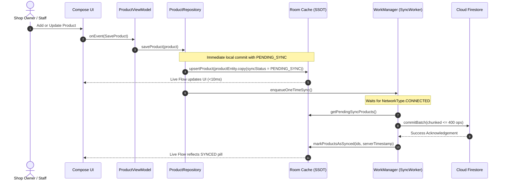

# 🏛️ ShopKeeper Architecture & System Design

This document details the architectural principles, system design, data flows, and engineering specifications of the **ShopKeeper** application.

---

## 📋 Table of Contents
1. [Architectural Overview](#1-architectural-overview)
2. [Offline-First Synchronization Engine](#2-offline-first-synchronization-engine)
3. [Monetary Modeling & Precision Engine](#3-monetary-modeling--precision-engine)
4. [Dependency Injection Architecture (Hilt)](#4-dependency-injection-architecture-hilt)
5. [Authentication & Multi-Tenant Data Isolation](#5-authentication--multi-tenant-data-isolation)
6. [Build Flavors & Release Optimization](#6-build-flavors--release-optimization)

---

## 1. Architectural Overview

ShopKeeper is built using modern Android architecture guidelines recommended by Google, following **Clean Architecture**, **MVI / MVVM**, and **Unidirectional Data Flow (UDF)**.

```mermaid
graph TD
    subgraph Presentation Layer [Presentation Layer (Jetpack Compose)]
        UI["Composables (Screens & Components)<br/>Material 3 + Edge-to-Edge"]
        VM["ViewModels (@HiltViewModel)<br/>ProductViewModel / AuthViewModel"]
    end

    subgraph Data Layer [Data Layer (Repositories)]
        Repo["ProductRepository<br/>UserSessionRepository"]
    end

    subgraph Local Storage [Local Data Sources (SSOT)]
        Room["Room Database (SQLite)<br/>AppDatabase v3 (Safe Migrations)"]
        Prefs["Preferences DataStore<br/>User Session & Shop Settings"]
    end

    subgraph Remote & Background [Remote Sources & Sync]
        WM["WorkManager Engine<br/>SyncWorker & SyncScheduler"]
        FS["Cloud Firestore<br/>Batch Writes (<= 400 ops)"]
        Auth["Credential Manager & Firebase Auth<br/>Google ID Token"]
    end

    UI -->|User Events| VM
    VM -->|StateFlow<UiState>| UI
    VM -->|Domain Requests| Repo
    Repo -->|Local Read/Write| Room
    Repo -->|Session Read/Write| Prefs
    Repo -->|Trigger Background Sync| WM
    WM -->|Read Pending Entities| Room
    WM -->|Upload Batch / Fetch Updates| FS
    FS -->|Real-time Snapshot Listener| Repo
```

### Layer Responsibilities
- **Presentation Layer**: Pure Jetpack Compose UI observing immutable `StateFlow<UiState>` via `collectAsStateWithLifecycle()`. User actions trigger sealed `UiEvent`s passed to the ViewModel.
- **Data Layer**: Repositories act as the single point of entry for data operations. Repositories coordinate between local and remote sources and are completely decoupled from Android UI contexts.
- **Local Data Layer (SSOT)**: The local Room database is the **Single Source of Truth**. The UI *only* observes and queries local Room data; it never queries remote APIs directly.
- **Background Sync Layer**: `WorkManager` manages asynchronous synchronization with Cloud Firestore under strict network constraints.

---

## 2. Offline-First Synchronization Engine

ShopKeeper guarantees **sub-10ms query times** regardless of network conditions by maintaining all active shop data in an indexed local SQLite database via Room.



### Sync Lifecycle States

Each product entity maintains a `syncStatus` attribute:

| State | Description | UI Representation |
| :--- | :--- | :--- |
| `SYNCED` | Local state matches Cloud Firestore. | Green checkmark pill |
| `PENDING_SYNC` | Modified locally while offline; queued for sync. | Amber clock pill |
| `SYNCING` | WorkManager or real-time listener currently uploading/downloading. | Blue spinning indicator |
| `SYNC_FAILED` | Network or server error during sync; exponential backoff active. | Red warning pill |

### Firestore Batch Chunking Specification
Cloud Firestore imposes a strict limit of 500 operations per batch write. To prevent catastrophic batch failure when importing large inventories or clearing backlogs, [`FirestoreService`](../app/src/main/java/com/shopkeeper/data/remote/FirestoreService.kt) chunks all write batches:

```kotlin
// Maximum 400 items per chunk (well below the 500-op limit)
products.chunked(400).forEach { batchList ->
    val batch = firestore.batch()
    batchList.forEach { product ->
        val docRef = shopCollection.document(product.id)
        batch.set(docRef, product.toMap())
    }
    batch.commit().await()
}
```

---

## 3. Monetary Modeling & Precision Engine

### The Problem with IEEE 754 Floating-Point
Using `Float` or `Double` for financial calculations leads to accumulation errors due to binary representation limits (e.g., `0.1 + 0.2 = 0.30000000000000004`). In retail inventory systems, compounding floating-point errors result in inaccurate tax, profit, and stock valuations.

### The Solution: 64-Bit Integer Minor Units
In ShopKeeper, all monetary amounts are stored internally as 64-bit integers (`Long`) representing the **minor unit** of the currency (cents, poisha, pennies, etc.):

- `$19.99` is stored as `1999L`
- `৳150.50` is stored as `15050L`
- `¥1000` is stored as `1000L`

### Mathematical Invariants & Formulas

$$\text{Unit Profit (Minor Units)} = \text{Selling Price (Minor)} - \text{Buying Price (Minor)}$$

$$\text{Profit Margin (\%)} = \left( \frac{\text{Selling Price} - \text{Buying Price}}{\text{Selling Price}} \right) \times 100$$

$$\text{Markup (\%)} = \left( \frac{\text{Selling Price} - \text{Buying Price}}{\text{Buying Price}} \right) \times 100$$

Conversion to user-facing strings occurs exclusively at presentation boundaries via [`FormatUtils`](../app/src/main/java/com/shopkeeper/ui/util/FormatUtils.kt).

---

## 4. Dependency Injection Architecture (Hilt)

Dagger Hilt manages all object lifecycles and inversion of control. The dependency graph is separated into distinct functional modules in `com.shopkeeper.di`:

```
com.shopkeeper.di/
├── DatabaseModule.kt    # Provides Room AppDatabase, ProductDao, and MIGRATION_2_3
├── NetworkModule.kt     # Provides FirebaseFirestore, FirebaseAuth, and NetworkMonitor
├── RepositoryModule.kt  # Binds ProductRepository and UserSessionRepository
└── SyncModule.kt        # Binds WorkManagerSyncScheduler and WorkManager instances
```

- `@Singleton`: Database instances, DAOs, repositories, and network monitors persist across the entire application lifecycle.
- `@ViewModelScoped`: ViewModels retain their dependencies during configuration changes (screen rotations) and release them when the back-stack entry is destroyed.

---

## 5. Authentication & Multi-Tenant Data Isolation

### Modern Google Credential Manager
Authentication utilizes the modern Android Credential Manager API (`androidx.credentials:credentials:1.3.0` and `googleid:1.1.1`):
1. User taps "Sign in with Google".
2. `CredentialManager.getCredential()` requests a Google ID Token (`GetGoogleIdOption`).
3. The returned Google ID Token is exchanged with Firebase Auth via `GoogleAuthProvider.getCredential(idToken, null)`.
4. Firebase returns a authenticated `FirebaseUser`.

### Multi-Tenant Access Model
Shops and inventory data are partitioned in Cloud Firestore:

```
firestore/
├── shops/
│   └── {shopId}/
│       ├── info/ (Shop metadata: name, currency, ownerUid)
│       ├── products/
│       │   └── {productId} (Product documents)
│       └── staff/
│           └── {email} (Staff access records)
└── users/
    └── {uid}/
        └── profile/ (Stores active shopId binding)
```

- **Owner**: Full administrative control, can invite staff members by Gmail, update currency, and delete shop records.
- **Staff**: Read and write access to inventory products; restricted from shop deletion and staff permission modification.

---

## 6. Build Flavors & Release Optimization

### Flavor Matrix

| Dimension | `dev` Flavor | `prod` Flavor |
| :--- | :--- | :--- |
| **Application ID** | `com.shopkeeper.dev` | `com.shopkeeper` |
| **App Title** | ShopKeeper Dev | ShopKeeper |
| **LeakCanary** | Enabled (`2.14`) | Excluded from compilation |
| **Crashlytics** | Optional | Full crash reporting active |
| **Coexistence** | Can be installed alongside production on the same device | Official production app |

### Release Minification (R8 & ProGuard)
Release builds enable aggressive tree-shaking, dead-code elimination, and identifier obfuscation:
- `isMinifyEnabled = true`
- `isShrinkResources = true`
- Custom `proguard-rules.pro` rules preserve:
  - Room entity schemas and type converters.
  - Cloud Firestore model serialization classes.
  - Dagger Hilt generated code and entry points.
  - Crashlytics mapping file generation.
