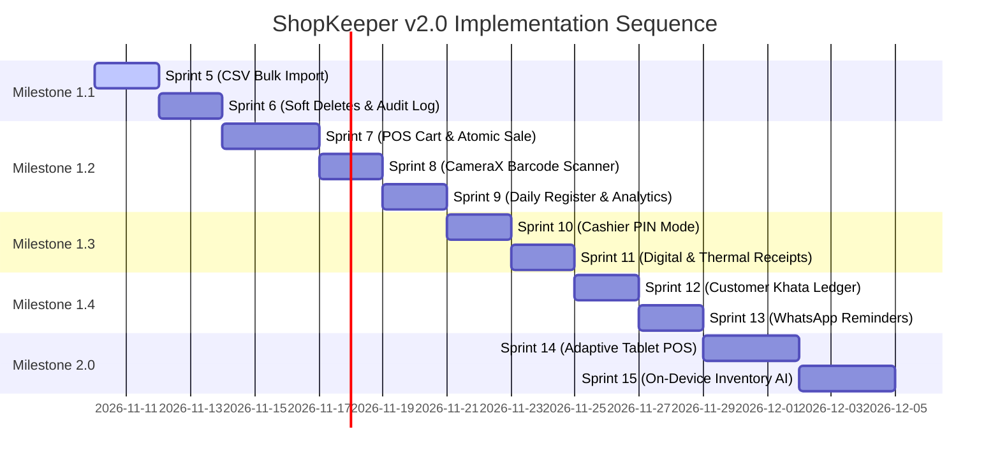

# 🏛️ ShopKeeper v2.0: Master Commercial Specification & Implementation Roadmap

> **Author:** Senior Principal Engineer & Android Systems Architect  
> **Target Version:** ShopKeeper v1.1.0 – v2.0.0  
> **Status:** Strategic Proposal (Pending Final Review & Approval)  
> **Architecture Pattern:** Clean Architecture + Unidirectional Data Flow (MVI/MVVM) + Room SSOT + Offline-First WorkManager  

---

## 🎯 Executive Summary & Architectural Invariants

This master document defines the end-to-end engineering roadmap to transform **ShopKeeper** from a single-user pricing catalog into a full-scale, commercial retail Point-of-Sale (POS), inventory management, and credit accounting platform.

### Non-Negotiable Engineering Invariants
1. **Monetary Precision (Zero-Float Rule):** Every currency value across inventory, carts, transactions, discounts, tax, and customer credit MUST be stored and computed as a 64-bit integer (`Long`) representing the currency's minor unit (cents/poisha). Floating-point arithmetic (`Double`/`Float`) is strictly forbidden for money.
2. **Room Database as the Single Source of Truth (SSOT):** The UI layer never mutates data in-memory or directly against remote services. All writes execute through Room DAOs inside `@Transaction` blocks; Cloud Firestore synchronization operates asynchronously in the background via Android `WorkManager`.
3. **100% Internationalization & String Localization:** Zero hardcoded strings in Kotlin source code or layouts. All user-facing text, error messages, dialogs, button labels, and receipt headers must reside in [`res/values/strings.xml`](file:///Users/kawsar/Desktop/projects/personal/Android/shop-purchase-management-app/app/src/main/res/values/strings.xml).
4. **Trunk-Based Delivery & Sub-Second Test Guardrails:** Every sprint delivers isolated, short-lived feature branches (`feat/<sprint-name>`). All PRs must pass tracked pre-push hooks (`testProdDebugUnitTest` + `lintProdDebug`) and GitHub Actions CI quality gates before merge. Unit test execution must remain sub-second.

---

## 🏗️ Target System Architecture

```mermaid
flowchart TD
    subgraph UI_Presentation [Presentation Layer (Jetpack Compose Material 3)]
        UI_Phone["Phone Layouts<br/>(Compact & Medium)"]
        UI_Tablet["Adaptive POS Terminal<br/>(Expanded Two-Pane)"]
        UI_Scanner["CameraX Viewfinder<br/>(ML Kit Barcode)"]
        UI_Cart["Quick Sale Cart<br/>(Live Pricing & Margin Tray)"]
        UI_Receipt["Receipt Renderer<br/>(WhatsApp Image/PDF + Thermal SPP)"]
    end

    subgraph Domain_Layer [Domain Layer (Use Cases & Business Logic)]
        UC_Sale["ProcessSaleUseCase<br/>(Atomic Stock Decrement + Ledger)"]
        UC_Import["ImportCatalogCsvUseCase<br/>(Streaming Validation & Dry-Run)"]
        UC_Credit["RecordCustomerCreditUseCase<br/>(Khata Ledger Balances)"]
        UC_AI["QueryLocalInventoryUseCase<br/>(Context Serializer + On-Device NLP)"]
        UC_Auth["VerifyCashierPinUseCase<br/>(Encrypted DataStore Masking)"]
    end

    subgraph Data_Layer [Data Layer (Room SSOT & Repositories)]
        Repo_Prod["ProductRepositoryImpl"]
        Repo_Sale["SaleTransactionRepositoryImpl"]
        Repo_Cust["CustomerLedgerRepositoryImpl"]
        Room_DB["Room Database (v4+ Migrations)<br/>- products (with soft delete)<br/>- stock_movement_audit<br/>- sale_transactions<br/>- sale_items<br/>- customers<br/>- customer_ledger_entries"]
    end

    subgraph Background_Engines [Infrastructure & External Hardware]
        Sync_WM["WorkManager Offline Sync Engine"]
        Firestore["Cloud Firestore Backend"]
        Printer["Bluetooth SPP ESC/POS Thermal Engine"]
        MLKit["Google Play Services ML Kit Barcode API"]
        LiteRT["LiteRT / Gemini Nano Prompt API"]
    end

    UI_Presentation --> Domain_Layer
    Domain_Layer --> Data_Layer
    Data_Layer --> Room_DB
    Data_Layer --> Sync_WM
    Sync_WM --> Firestore
    UI_Presentation --> Printer
    UI_Presentation --> MLKit
    Domain_Layer --> LiteRT
```

---

## 🗺️ Milestone & Sprint Breakdown

The roadmap is structured into **5 sequential Milestones** across **11 focused Sprints (Sprints 5 through 15)**:

| Milestone | Title | Sprints | Focus Area |
| :---: | :--- | :---: | :--- |
| **Milestone 1.1** | Data Mobility & Safeguards | Sprint 5 – 6 | Bulk CSV Import, Soft Deletes, Trash Bin & Stock Audit Logs |
| **Milestone 1.2** | Point-of-Sale & Fast Scanning | Sprint 7 – 9 | Quick Sale Cart, CameraX Barcode Scanner, Daily Cash Register |
| **Milestone 1.3** | Counter Privacy & Proof of Purchase | Sprint 10 – 11 | Cashier vs. Owner PIN Mode, Digital Receipts, Thermal Printing |
| **Milestone 1.4** | Working Capital & Credit ("Khata") | Sprint 12 – 13 | Customer Credit Ledger, Due Dates, WhatsApp Reminders |
| **Milestone 2.0** | Commercial Hardware & Intelligence | Sprint 14 – 15 | Adaptive Tablet Two-Pane POS, On-Device AI Inventory Assistant |

---

### 📦 Milestone 1.1: Data Mobility & Operational Safeguards

#### 🏃 Sprint 5: Bi-Directional Bulk CSV/Excel Importer
- **Objective:** Enable new and existing merchants to bulk import hundreds of products in seconds using standard spreadsheets without manually entering items one by one.
- **Architectural Scope:**
  - Create `CsvImporter.kt` utilizing Android Storage Access Framework (`ActivityResultContracts.OpenDocument`).
  - Implement streaming parser that handles CSV, UTF-8 with BOM, and header auto-detection (`Product Code`, `Name`, `Category`, `Buying Price`, `Selling Price`, `Stock`).
  - Build dry-run validation engine that detects invalid price formats, missing required fields, and duplicate codes.
  - Implement `CsvImportPreviewDialog.kt` showing total valid rows, error rows, and overwrite options.
  - Execute batch insert in Room: `@Transaction suspend fun importProducts(products: List<ProductEntity>, overwriteDuplicates: Boolean)`.
- **Sprint 5 Tasks & Checklist:**
  - [ ] **Task 5.1:** Implement `CsvParser` utility with delimiter detection (comma, semicolon, tab) and currency string sanitization.
  - [ ] **Task 5.2:** Add `ProductDao.upsertAll()` and batch insert resolution logic.
  - [ ] **Task 5.3:** Build `ImportProductsUseCase` with dry-run validation result model (`Valid`, `Warning`, `Fatal`).
  - [ ] **Task 5.4:** Create Compose `ImportPreviewBottomSheet` with summary counters and error inspection list.
  - [ ] **Task 5.5:** Add unit tests for malformed CSVs, mixed encodings, decimal vs comma currencies, and large file streaming.

#### 🏃 Sprint 6: Soft Deletes, Recycle Bin & Stock Audit Log
- **Objective:** Prevent irreversible accidental inventory loss in fast-paced retail environments and create an immutable audit trail of all inventory quantity adjustments.
- **Architectural Scope:**
  - **Room Database Migration v3 $\rightarrow$ v4:**
    - Add `isDeleted: Boolean = false` and `deletedAt: Long? = null` to `ProductEntity`.
    - Create `stock_movement_logs` table: `id`, `productId`, `previousStock`, `newStock`, `delta`, `reason` (`RESTOCK`, `SALE`, `RETURN`, `DAMAGE`, `AUDIT_CORRECTION`), `timestamp`.
  - Update all inventory queries to filter `WHERE isDeleted = 0`.
  - Implement "Recycle Bin / Trash" screen accessible from Settings/Drawer with a 30-day auto-purge and 1-tap **"Restore"** capability.
- **Sprint 6 Tasks & Checklist:**
  - [ ] **Task 6.1:** Define `Migration_3_4` and create migration test in `AppDatabaseTest`.
  - [ ] **Task 6.2:** Create `StockMovementLogEntity` and `StockMovementDao`.
  - [ ] **Task 6.3:** Refactor `DeleteProductUseCase` to soft-delete by updating `isDeleted = true` and `deletedAt = System.currentTimeMillis()`.
  - [ ] **Task 6.4:** Build `TrashBinScreen` Composable with "Restore" and "Permanently Delete" actions.
  - [ ] **Task 6.5:** Record audit logs on every stock modification and verify via automated unit tests.

---

### 💳 Milestone 1.2: Point-of-Sale (POS) & Fast Scanning

#### 🏃 Sprint 7: Ephemeral Cart & Atomic Sale Checkout
- **Objective:** Turn inventory browsing into a fast checkout terminal where items can be accumulated into a shopping tray and checked out with automatic stock reduction.
- **Architectural Scope:**
  - Create `CartItem` model: product reference, quantity, unit selling price, unit cost, line subtotal, line profit.
  - Create `SaleTransactionEntity` and `SaleItemEntity` in Room (Migration v4 $\rightarrow$ v5).
  - Implement `CartViewModel` state machine (Add, Increment, Decrement, Remove, Apply Discount %, Clear).
  - Implement atomic `@Transaction` checkout:
    ```kotlin
    @Transaction
    suspend fun checkoutSale(sale: SaleTransactionEntity, items: List<SaleItemEntity>) {
        items.forEach { item ->
            productDao.decrementStock(item.productId, item.quantity)
            stockDao.insertLog(StockMovementLog(...))
        }
        transactionDao.insertSale(sale)
        transactionDao.insertSaleItems(items)
    }
    ```
- **Sprint 7 Tasks & Checklist:**
  - [ ] **Task 7.1:** Design Room schema for `sale_transactions` and `sale_items` with foreign keys and cascade rules.
  - [ ] **Task 7.2:** Implement `ProcessSaleUseCase` enforcing stock availability and non-negative total math.
  - [ ] **Task 7.3:** Build expandable bottom-sheet `QuickSaleCartBar` showing item count, total price, and "Checkout" CTA.
  - [ ] **Task 7.4:** Build `CheckoutDialog` with Cash Tendered calculator (auto-calculates exact customer change due).
  - [ ] **Task 7.5:** Add comprehensive unit tests verifying money summation, stock decrement atomicity, and rollback on error.

#### 🏃 Sprint 8: CameraX + Google ML Kit Barcode Scanner
- **Objective:** Provide sub-200ms camera barcode/QR scanning directly integrated into both product creation and the active POS checkout tray.
- **Architectural Scope:**
  - Add Google Play Services unbundled ML Kit Barcode dependency (`play-services-mlkit-barcode-scanning:18.3.0`) to keep APK size minimal.
  - Implement CameraX `ImageAnalysis` analyzer with throttling and bounding box focus.
  - Support EAN-13, EAN-8, UPC-A, UPC-E, Code 128, Code 39, and QR codes.
  - Dual-mode invocation:
    1. **In-Sale Scan Mode:** Point camera at barcode $\rightarrow$ plays haptic click/beep $\rightarrow$ automatically increments item in cart.
    2. **Product Form Mode:** 1-tap scan to populate `productCode` field in the Add/Edit Product sheet.
  - Runtime camera permission workflow with rationale dialog and camera unavailable fallback.
- **Sprint 8 Tasks & Checklist:**
  - [ ] **Task 8.1:** Add CameraX & ML Kit dependencies and configure Camera permissions in `AndroidManifest.xml`.
  - [ ] **Task 8.2:** Implement `BarcodeAnalyzer` class with lifecycle-bound CameraX preview.
  - [ ] **Task 8.3:** Create `BarcodeScannerOverlay` Composable with target viewfinder and flash toggle.
  - [ ] **Task 8.4:** Wire barcode scan stream into `CartViewModel` and `ProductViewModel`.
  - [ ] **Task 8.5:** Implement haptic feedback (`HapticFeedbackType.LongPress`) and audio feedback on successful decode.

#### 🏃 Sprint 9: Daily Cash Register & Revenue Analytics
- **Objective:** Provide the store owner with instant visibility into daily financial performance: revenue, cost of goods sold (COGS), net profit, and sales count.
- **Architectural Scope:**
  - Implement `DailyRegisterDao` with optimized Room aggregation queries:
    ```sql
    SELECT 
        COUNT(id) AS totalTransactions,
        COALESCE(SUM(totalRevenueMinor), 0) AS totalRevenue,
        COALESCE(SUM(totalProfitMinor), 0) AS totalProfit
    FROM sale_transactions 
    WHERE timestamp >= :startOfDay AND timestamp <= :endOfDay;
    ```
  - Create **"Today's Register"** dashboard card at the top of the main screen (collapsible/expandable).
  - Build `TransactionHistoryScreen` listing sales with date-range filters (Today, Yesterday, This Week, Custom) and sale detail inspection.
- **Sprint 9 Tasks & Checklist:**
  - [ ] **Task 9.1:** Implement date aggregation queries in `SaleTransactionDao`.
  - [ ] **Task 9.2:** Create `GetDailySummaryUseCase` returning type-safe `DailyRegisterSummary`.
  - [ ] **Task 9.3:** Build `TodayRegisterCard` Composable with revenue, net profit, and profit margin badge.
  - [ ] **Task 9.4:** Build `TransactionHistoryScreen` with paginated transaction cards and itemized breakdowns.
  - [ ] **Task 9.5:** Add unit tests verifying accurate day-boundary time math and aggregation correctness.

---

### 🛡️ Milestone 1.3: Counter Trust, Privacy & Receipts

#### 🏃 Sprint 10: Cashier vs. Owner Privacy PIN Mode
- **Objective:** Allow store owners to safely hand their device to staff or cashiers without exposing buying prices, profit margins, or settings.
- **Architectural Scope:**
  - Implement `PrivacyModeManager` utilizing AndroidX `EncryptedDataStore` for secure 4-digit PIN storage and Argon2/PBKDF2 hashing.
  - Introduce `AppUserRole`: `OWNER` (unrestricted) vs. `CASHIER` (restricted).
  - When in `CASHIER` mode:
    - Main inventory cards mask or hide **Buying Price** and **Profit Margin**.
    - Sales tray displays only **Selling Price** and totals.
    - Settings, CSV Export, Account Deletion, and Price Editing are locked behind PIN challenge dialog.
  - 1-tap quick toggle in TopBar to lock into Cashier Mode.
- **Sprint 10 Tasks & Checklist:**
  - [ ] **Task 10.1:** Implement `SecurityPreferences` with encrypted PIN persistence and lockout cooldown after 5 failed attempts.
  - [ ] **Task 10.2:** Create `UserRoleState` exposed through Hilt singleton `SessionManager`.
  - [ ] **Task 10.3:** Update `ProductCard` and `ProductDetail` Composables to conditionally render margins and purchase prices.
  - [ ] **Task 10.4:** Build `PinChallengeDialog` and `SetPinDialog` with numeric keypad.
  - [ ] **Task 10.5:** Add unit tests for PIN validation, failed attempt exponential backoff, and state masking.

#### 🏃 Sprint 11: Digital Receipts & ESC/POS Bluetooth Thermal Printing
- **Objective:** Give customers immediate proof of purchase via WhatsApp/SMS digital shares or physical printed 58mm/80mm counter receipts.
- **Architectural Scope:**
  - **Digital Receipt Capture:**
    - Design clean, branded `ReceiptLayout` Composable (Store Name, Date, Receipt #, Itemized Rows, Total, Cash Tendered, Change, Thank You message).
    - Use Compose `rememberGraphicsLayer()` to capture the view as a high-resolution Bitmap/PNG or PDF.
    - Share via Android Sharesheet (`Intent.ACTION_SEND`).
  - **Bluetooth Thermal Printing (ESC/POS):**
    - Implement native, lightweight Kotlin ESC/POS bytecode serializer (text alignment, bold, font sizes, line feeds, paper cut commands).
    - Connect to paired Bluetooth printers via standard RFCOMM/SPP (`BluetoothSocket`) without external cloud print services.
- **Sprint 11 Tasks & Checklist:**
  - [ ] **Task 11.1:** Build `ReceiptFormatter` generating standardized ASCII text and formatted printable bitmaps.
  - [ ] **Task 11.2:** Implement `EscPosDriver` supporting standard ESC/POS command sequences (58mm and 80mm widths).
  - [ ] **Task 11.3:** Build `BluetoothPrinterManager` to discover paired SPP devices and maintain connection lifecycles.
  - [ ] **Task 11.4:** Implement `ReceiptPreviewDialog` with "Share Digital Receipt" and "Print Physical Receipt" buttons.
  - [ ] **Task 11.5:** Add unit tests verifying byte stream generation and printer buffer limits.

---

### 📒 Milestone 1.4: Working Capital & Credit Ledger ("Khata")

#### 🏃 Sprint 12: Customer Credit & Accounts Receivable Ledger
- **Objective:** Capture neighborhood retail credit sales ("Udhar / Due"), tracking exactly who owes what and managing partial payments.
- **Architectural Scope:**
  - **Room Schema Expansion (Migration v5 $\rightarrow$ v6):**
    - `customers`: `id`, `name`, `phoneNumber`, `address`, `currentBalanceMinor`, `createdAt`.
    - `customer_ledger_entries`: `id`, `customerId`, `transactionId?`, `amountMinor`, `type` (`CREDIT_SALE`, `PAYMENT_RECEIVED`, `ADJUSTMENT`), `notes`, `timestamp`, `dueDate`.
  - Link checkout flow to optional customer assignment.
  - Build `CustomerDirectoryScreen` and `CustomerDetailLedgerScreen`.
- **Sprint 12 Tasks & Checklist:**
  - [ ] **Task 12.1:** Create `CustomerEntity` and `CustomerLedgerEntryEntity` Room models and DAOs.
  - [ ] **Task 12.2:** Implement `RecordCustomerPaymentUseCase` updating customer running balances atomically.
  - [ ] **Task 12.3:** Add customer selector in checkout dialog with Android Contacts picker interop.
  - [ ] **Task 12.4:** Build `CustomerLedgerScreen` displaying chronological timeline of sales, dues, and payments.
  - [ ] **Task 12.5:** Add unit tests validating running balance reconciliation and transaction rollback.

#### 🏃 Sprint 13: WhatsApp Payment Reminders & Settlement
- **Objective:** Allow merchants to send respectful, localized payment reminders with itemized balance summaries in a single tap via WhatsApp.
- **Architectural Scope:**
  - Create `ReminderTemplateGenerator` generating localized payment messages:
    > *"Dear [Customer Name], your outstanding balance at [Store Name] is [Amount]. Last transaction on [Date]. Thank you for your continued business!"*
  - Integrate direct WhatsApp URI deep link: `https://api.whatsapp.com/send?phone=[number]&text=[encodedText]`.
  - Implement full balance settlement and partial balance payment workflows with receipt generation.
- **Sprint 13 Tasks & Checklist:**
  - [ ] **Task 13.1:** Implement string template generator in `strings.xml` for polite billing reminders.
  - [ ] **Task 13.2:** Build `SendPaymentReminderUseCase` formatting WhatsApp and SMS intent URLs.
  - [ ] **Task 13.3:** Build `SettlePaymentDialog` with instant receipt issuance.
  - [ ] **Task 13.4:** Add "Overdue Accounts" filter tab on the customer dashboard.
  - [ ] **Task 13.5:** Add unit tests for reminder message formatting and telephone number sanitization.

---

### 🚀 Milestone 2.0: Commercial Hardware & Intelligence

#### 🏃 Sprint 14: Adaptive Layouts & Tablet POS (Two-Pane Terminal)
- **Objective:** Scale ShopKeeper into an enterprise retail counter terminal for 10" tablets, foldables, and ChromeOS desktop registers.
- **Architectural Scope:**
  - Integrate `androidx.compose.material3.adaptive:adaptive` and `WindowWidthSizeClass`.
  - **Expanded Layout ($\ge 840\text{ dp}$):**
    - **Left Pane (40% width):** Fast product search, category chips, and live catalog grid.
    - **Right Pane (60% width):** Persistent active sale tray / cart, quick cash buttons, customer selector, and tender controls.
  - Ensure zero state loss during screen rotation or foldable folding/unfolding.
- **Sprint 14 Tasks & Checklist:**
  - [ ] **Task 14.1:** Add AndroidX Compose Adaptive dependencies.
  - [ ] **Task 14.2:** Implement `AdaptivePosScaffold` switching between single-pane mobile and two-pane tablet configurations.
  - [ ] **Task 14.3:** Build dedicated `TabletCartPane` with large touch targets for cash register counters.
  - [ ] **Task 14.4:** Verify layout rendering on Android Emulator tablet profiles (Pixel Tablet, Foldable unfolded).
  - [ ] **Task 14.5:** Add Compose screenshot/UI regression tests for Compact, Medium, and Expanded window size classes.

#### 🏃 Sprint 15: On-Device Inventory AI Assistant
- **Objective:** Provide instant, natural-language business insights that run **100% locally on the device** (zero cloud API fees, 0 ms network latency, and complete business privacy).
- **Architectural Scope:**
  - Implement `LocalInventoryContextSerializer` extracting compact structured summaries (low-stock items, top-margin categories, inventory valuation, dormant items).
  - Primary Backend: **ML Kit GenAI Prompt API / Gemini Nano** on supported Android AICore devices.
  - Secondary Backend: Deterministic local rule-based NLP query parser for non-NPU budget devices.
  - Supported conversational questions:
    - *"What products are running out of stock?"*
    - *"Which category gives me the highest profit margin?"*
    - *"What is my total cash investment in inventory?"*
    - *"Which items haven't had sales this week?"*
- **Sprint 15 Tasks & Checklist:**
  - [ ] **Task 15.1:** Implement `InventoryContextSerializer` producing minimal JSON tokens.
  - [ ] **Task 15.2:** Build `OnDeviceAiEngine` abstraction with Gemini Nano and fallback query parsers.
  - [ ] **Task 15.3:** Build `AiAssistantBottomSheet` conversational UI with quick-prompt chips.
  - [ ] **Task 15.4:** Add offline guardrails ensuring zero network requests are dispatched during AI inference.
  - [ ] **Task 15.5:** Add unit tests for structured intent parsing and deterministic calculation accuracy.

---

## 🚦 Definition of Done (DoD) per Sprint

No sprint may be marked complete or merged into `main` without satisfying:

1. ✅ **Unit Test Pass Rate:** 100% passing unit tests (`./gradlew testProdDebugUnitTest`) with execution under 2 seconds.
2. ✅ **Zero Android Lint Regressions:** Clean static analysis report (`./gradlew lintProdDebug`).
3. ✅ **Architecture Invariant Verification:** [`ArchitectureInvariantsTest`](file:///Users/kawsar/Desktop/projects/personal/Android/shop-purchase-management-app/app/src/test/java/com/shopkeeper/architecture/ArchitectureInvariantsTest.kt) passes, ensuring zero `Double`/`Float` monetary fields and zero unlocalized strings.
4. ✅ **Release Compilation:** Successful ProGuard/R8 minified build (`./gradlew assembleProdRelease`).
5. ✅ **Trunk-Based PR Flow:** Clean PR with concise description, atomic commits, and passing GitHub Actions CI quality gates.
6. ✅ **Documentation Update:** Update [`ROADMAP.md`](file:///Users/kawsar/Desktop/projects/personal/Android/shop-purchase-management-app/ROADMAP.md) and [`docs/sprints/SPRINT_TRACKER.md`](file:///Users/kawsar/Desktop/projects/personal/Android/shop-purchase-management-app/docs/sprints/SPRINT_TRACKER.md).

---

## 📅 Suggested Execution Flow


