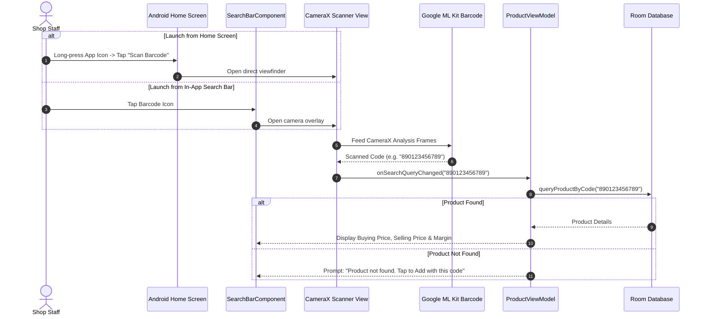
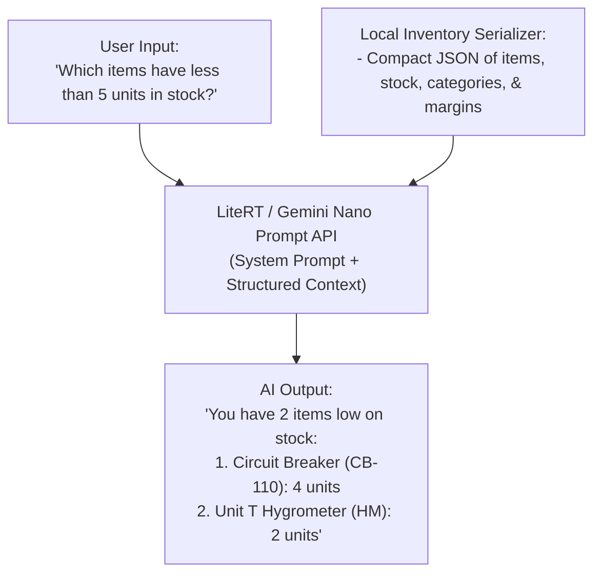

# 🚀 ShopKeeper v2.0: Commercial Evolution & Advanced Capabilities Specification

> **Engineering Vision:** Elevate ShopKeeper from a robust mobile pricing assistant into a full-featured, enterprise-grade retail Point-of-Sale (POS) and inventory platform. This specification outlines the architecture, dependencies, data flows, and verification criteria for **Phases 1 through 4**.

---

## 🗺️ Master Roadmap & Phase Progression

```mermaid
flowchart TD
    subgraph Phase 1 [Phase 1: Baseline Quality & Security Audits]
        P1A["Google Play Policy Audit<br/>(play-policy-insights)"]
        P1B["R8 Binary Size & ProGuard Optimization<br/>(r8-analyzer)"]
    end

    subgraph Phase 2 [Phase 2: Retail Utility Features]
        P2A["CameraX + ML Kit Barcode Scanner<br/>(Instant code lookup & auto-fill)"]
        P2B["Android Launcher Quick Shortcuts<br/>(Scan, Search, Add, Export)"]
    end

    subgraph Phase 3 [Phase 3: Adaptive Layouts & Tablet POS]
        P3A["Window Size Class Detection<br/>(Compact vs. Expanded)"]
        P3B["Two-Pane List-Detail POS Dashboard<br/>(List on left, Details/Margin on right)"]
    end

    subgraph Phase 4 [Phase 4: On-Device Inventory Intelligence]
        P4A["Local Context Serializer<br/>(Low stock, margins, valuations)"]
        P4B["On-Device AI Assistant<br/>(Prompt API / LiteRT - 0ms, $0 cost)"]
    end

    Phase 1 --> Phase 2
    Phase 2 --> Phase 3
    Phase 3 --> Phase 4
```

---

## 🏁 Phase 1: Baseline Quality & Security Audits

### 1.1 Objectives
1. **Google Play Policy Hygiene**: Audit `AndroidManifest.xml`, dependencies, and data handling using the `play-policy-insights` skill to identify undeclared permissions, architectural risks, and missing privacy disclosures before publishing.
2. **Binary Optimization**: Inspect the `prodRelease` APK and App Bundle (`.aab`) using `r8-analyzer` to benchmark exact bundle size, remove redundant keep rules, and verify that debug logging is completely stripped.

### 1.2 Execution Plan
- **Task 1.1**: Run `play-policy-insights` automated audit:
  - Cross-reference permissions: `android.permission.INTERNET`, `android.permission.ACCESS_NETWORK_STATE`, and `FileProvider`.
  - Validate Credential Manager & Firebase Auth Google Sign-In scopes.
  - Generate Play Store Data Safety disclosure recommendations.
- **Task 1.2**: Run `r8-analyzer` optimization scan:
  - Benchmark APK size of `app-prod-release.apk` and download size of `app-prod-release.aab`.
  - Verify that `proguard-rules.pro` keeps all necessary Room, Hilt, and Firestore serialization classes while stripping unneeded metadata.
- **Task 1.3**: Output findings to `docs/reports/` for audit trail.

---

## 📦 Phase 2: Retail Utility (Barcode Scanner + App Shortcuts)

### 2.1 Objectives
Enable instant physical scanning of product barcodes/QR codes at the checkout counter and provide Android home-screen quick actions.

### 2.2 System Architecture & Flow



### 2.3 Required Dependencies & Permissions
```kotlin
// In app/build.gradle.kts:
implementation("androidx.camera:camera-camera2:1.3.2")
implementation("androidx.camera:camera-lifecycle:1.3.2")
implementation("androidx.camera:camera-view:1.3.2")
// Unbundled Google Play Services ML Kit Barcode (minimizes APK size):
implementation("com.google.android.gms:play-services-mlkit-barcode-scanning:18.3.0")
```
- **Permission**:
  ```xml
  <uses-feature android:name="android.hardware.camera" android:required="false" />
  <uses-permission android:name="android.permission.CAMERA" />
  ```
  Runtime permission check implemented via Accompanist or Compose `rememberLauncherForActivityResult`.

### 2.4 Android Launcher Shortcuts (`res/xml/shortcuts.xml`)
Provide 4 static launcher shortcuts:
1. 📷 **Scan Barcode**: Launches `MainActivity` with deep link `shopkeeper://scan`
2. 🔍 **Quick Search**: Launches `MainActivity` with deep link `shopkeeper://search` (keyboard auto-opens)
3. ➕ **Add Product**: Launches `MainActivity` with deep link `shopkeeper://add_product`
4. 📊 **Export Inventory**: Launches `MainActivity` with deep link `shopkeeper://export_csv`

---

## 🖥️ Phase 3: Adaptive Layouts & Tablet POS

### 3.1 Objectives
Provide an adaptive experience that scales gracefully from compact phones (single pane) to tablets, foldables, and desktop POS terminals (two-pane dashboard).

### 3.2 Layout Specifications

| Window Size Class | Screen Width | Target Devices | Layout Mode |
| :--- | :--- | :--- | :--- |
| **Compact** | $< 600\text{ dp}$ | Standard Phones | Single-pane navigation (current flow) |
| **Medium** | $600\text{ dp} - 839\text{ dp}$ | Foldables unfolded, Small Tablets | Adaptive navigation rail + single pane |
| **Expanded** | $\ge 840\text{ dp}$ | 10" Tablets, ChromeOS, Desktop POS | **Two-Pane List-Detail Dashboard** |

```
┌─────────────────────────────────────────────────────────────────────────────┐
│ Expanded Screen (Tablets & POS Counters)                                    │
├──────────────────────────────────┬──────────────────────────────────────────┤
│ Left Pane (40% Width)            │ Right Pane (60% Width)                   │
│                                  │                                          │
│ [🔍 Search Product Code / Name]  │ 📦 Product Detail: [ Bluetooth Mouse ]   │
│ [🏷️ Category Filter Chips]       │                                          │
│                                  │ ┌──────────────────┐ ┌─────────────────┐ │
│ ┌──────────────────────────────┐ │ │ BUYING PRICE     │ │ SELLING PRICE   │ │
│ │ BT-778 - Bluetooth Mouse     │ │ │ $12.00           │ │ $18.50          │ │
│ │ Selling: $18.50  Stock: 25   │ │ └──────────────────┘ └─────────────────┘ │
│ ├──────────────────────────────┤ │ Profit: +$6.50 (+35.1% margin)           │
│ │ CB-110 - Circuit Breaker     │ │                                          │
│ │ Selling: $4.20   Stock: 4    │ │ Stock Controls:  [ - ]  [ 25 ]  [ + ]    │
│ ├──────────────────────────────┤ │                                          │
│ │ MK-99 - Mechanical Keyboard  │ │ Category: Electronics                    │
│ │ Selling: $45.00  Stock: 12   │ │ [ ✏️ Edit Product ]  [ 🗑️ Delete ]       │
│ └──────────────────────────────┘ │                                          │
└──────────────────────────────────┴──────────────────────────────────────────┘
```

### 3.3 Implementation Details
- Uses `androidx.compose.material3.adaptive:adaptive` to detect `WindowWidthSizeClass`.
- Introduces `ProductDetailPane.kt` displaying full stock breakdown, quick stock $+/-$ incrementers, and profit calculators.
- Preserves selected product state across screen rotations and folding/unfolding gestures.

---

## 🧠 Phase 4: On-Device Inventory AI Assistant

### 4.1 Objectives
Empower shopkeepers with instant, natural-language conversational queries about their inventory that run **100% on the device** with **zero latency, zero monthly API bills, and total data privacy**.

### 4.2 System Architecture



### 4.3 Supported Conversational Queries
1. **Low Stock Alerts**: *"What products are running out of stock?"*
2. **Profit & Margin Insights**: *"Which category gives me the highest profit margin?"*
3. **Valuation Summaries**: *"What is my total buying investment in Electronics?"*
4. **Dead Stock Identification**: *"Which items haven't had stock changes recently?"*

### 4.4 Hardware & Fallback Strategy
- Primary backend: **ML Kit GenAI Prompt API / Gemini Nano** (on supported Android devices).
- Fallback: Deterministic local rule-based NLP query parser for devices without NPU/GPU AI Core support, guaranteeing that every shop owner gets instant answers regardless of device specs.

---

## 🚦 Phase Quality Gates & Verification Matrix

| Phase | Milestone Name | Mandatory Verification Checks |
| :---: | :--- | :--- |
| **Phase 1** | Baseline Audits | `./gradlew lintProdDebug`, zero Play Policy violations, baseline APK size recorded. |
| **Phase 2** | Retail Utility | CameraX preview renders $\ge 30\text{ fps}$, barcode decoded in $< 200\text{ ms}$, shortcuts launch deep links. |
| **Phase 3** | Adaptive Layouts | Verified across Phone (Compact), Foldable (Medium), and Tablet (Expanded) layout classes. |
| **Phase 4** | On-Device AI | On-device response generated in $< 1\text{ s}$, zero network requests made. |
