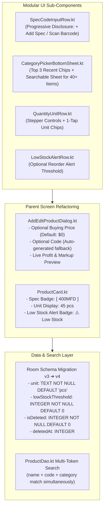

# 📋 Sprint 4.5 Implementation Plan: Frictionless Product Creation Experience

> **Milestone:** Foundation Enhancement (Pre-Milestone 1.1)  
> **Sprint:** Sprint 4.5  
> **Branch:** `feat/product-form-experience`  
> **Target Audience:** All Retail Types (Groceries, Hardware, Electrical, General Retail) via Google Play Store  
> **Architectural Pattern:** Clean Architecture + Room SSOT + Compose Material 3 (Progressive Disclosure)  

---

## 🎯 Executive Goal

Transform the product creation and editing experience in **ShopKeeper** from a rigid, technical form into an intuitive, confusion-proof, high-speed retail tool. 

The new experience:
1. **Never confuses non-technical grocers** with technical jargon or mandatory code fields.
2. **Empowers specialized hardware/electrical merchants** with instant shorthand spec lookup (e.g. `ABS 400MFD`).
3. **Supports loose vs. packaged goods** via unit selection (`pcs`, `kg`, `box`, `pkt`).
4. **Prevents stockouts** via configurable low-stock alert thresholds.
5. **Maintains a single unified Room schema migration (v3 $\rightarrow$ v4)** ensuring zero technical debt before Sprint 5 Bulk CSV Import.

---

## 🏗️ Architecture & Component Architecture



---

## 📋 Comprehensive Sprint Checklist

### Part 1: Unified Room Schema Evolution (Migration v3 $\rightarrow$ v4)
- [ ] **Task 1.1: Update `ProductEntity.kt`**
  - Add `unit: String = "pcs"`
  - Add `lowStockThreshold: Int = 0`
  - Add `isDeleted: Boolean = false`
  - Add `deletedAt: Long? = null`
  - Update `toDomain()` and `fromDomain()` mapping functions.
- [ ] **Task 1.2: Update Domain Model `Product.kt`**
  - Propagate `unit: String` and `lowStockThreshold: Int`.
- [ ] **Task 1.3: Author Room `Migration_3_4` in `AppDatabase.kt`**
  - Bump `version = 4`.
  - Add SQL DDL:
    ```sql
    ALTER TABLE products ADD COLUMN unit TEXT NOT NULL DEFAULT 'pcs';
    ALTER TABLE products ADD COLUMN lowStockThreshold INTEGER NOT NULL DEFAULT 0;
    ALTER TABLE products ADD COLUMN isDeleted INTEGER NOT NULL DEFAULT 0;
    ALTER TABLE products ADD COLUMN deletedAt INTEGER DEFAULT NULL;
    ```
- [ ] **Task 1.4: Update Inventory Query Filters**
  - In `ProductDao.kt`, update queries to include `WHERE isDeleted = 0`.
- [ ] **Task 1.5: Automated Migration Test in `AppDatabaseTest.kt`**
  - Write test verifying migration from v3 schema to v4 preserves existing rows with valid defaults.

---

### Part 2: Modular UI Component Creation
- [ ] **Task 2.1: `SpecCodeInputRow.kt`**
  - Render progressive disclosure row: `[ + Add Spec / Model ]` and `[ 📷 Scan Barcode ]`.
  - When expanded, shows text field:
    - Label: `Short Code / Model / Spec (Optional)`
    - Placeholder: `e.g. 400MFD, 100W, 12V, Size XL`
    - Trailing close/collapse icon.
- [ ] **Task 2.2: `CategoryPickerBottomSheet.kt`**
  - Show Top 2–3 recent/frequent category chips directly in dialog.
  - Show `[ 🔍 More (42)... ]` chip.
  - When tapped, slides up bottom sheet with:
    - Search field with auto-focus.
    - `[ + Create New Category ]` dynamic button.
    - Alphabetical list of categories with item counts.
- [ ] **Task 2.3: `QuantityUnitRow.kt`**
  - Stepper controls: `[ - ]` [ Quantity ] `[ + ]`.
  - Unit chips: `[ pcs ]`, `[ kg ]`, `[ box ]`, `[ pkt ]`, `[ m ]`, `[ ltr ]` (selected unit highlighted).
- [ ] **Task 2.4: `LowStockAlertRow.kt`**
  - Checkbox / Switch: `Alert me when low on stock`.
  - Threshold stepper input: `Threshold: [ 5 ] pcs`.

---

### Part 3: `AddEditProductDialog.kt` Refactoring & Forgiving Validation
- [ ] **Task 3.1: Forgiving Validation Rules**
  - Remove mandatory constraint on `code`: auto-generate `#1001` if empty.
  - Remove mandatory constraint on `buyingPrice`: default to `$0.00` if blank.
  - Remove mandatory constraint on `category`: default to `"General"` if blank.
  - Only **Product Name** and **Selling Price** are strictly required.
- [ ] **Task 3.2: Live Profit & Loss Preview Box**
  - Display `$profitSign$currencySymbol$profitVal ($markupSign$markupPercent% markup)`.
  - Show green container for profit, red alert container if selling price < buying price.
- [ ] **Task 3.3: 100% String Localization**
  - Add all new labels, placeholders, unit names, and dialog headers to `res/values/strings.xml`.

---

### Part 4: Inventory Presentation & Multi-Token Search
- [ ] **Task 4.1: Update `ProductCard.kt`**
  - Display spec as prominent badge: `[ 400MFD ] ABS Capacitor`.
  - Display stock with units: `Stock: 45 pcs` or `Stock: 12.5 kg`.
  - Display `⚠️ Low Stock (X left)` badge when `quantity <= lowStockThreshold && lowStockThreshold > 0`.
- [ ] **Task 4.2: Implement Multi-Token Search in `ProductDao.kt`**
  - Split user search input by spaces (`"ABS 400"` $\rightarrow$ `["ABS", "400"]`).
  - Search simultaneously across `name`, `code`, and `category` so word order does not matter.

---

### Part 5: Quality Gates & Verification Matrix
- [ ] **Task 5.1: Unit Test Suite Pass Rate**
  - Run `./gradlew testProdDebugUnitTest` (all tests passing in $< 2\text{s}$).
- [ ] **Task 5.2: Static Analysis**
  - Run `./gradlew lintProdDebug` (0 errors).
- [ ] **Task 5.3: Architecture Invariant Test**
  - Verify `ArchitectureInvariantsTest` passes (zero `Double`/`Float` monetary values, 100% strings localized).
- [ ] **Task 5.4: Release Compilation**
  - Run `./gradlew assembleProdRelease` to verify R8/ProGuard minification.
- [ ] **Task 5.5: Pull Request & CI Quality Gate**
  - Open PR `feat/product-form-experience` $\rightarrow$ `main`.
  - Verify GitHub Actions CI quality gates pass and squash-merge.

---

## ⏱️ Estimated Effort & Risk
- **Effort:** 1 Sprint (~1.5 days).
- **Risk Level:** Low.
- **Rollback Safety:** Backed by automated Room migration tests and Git branch isolation.
